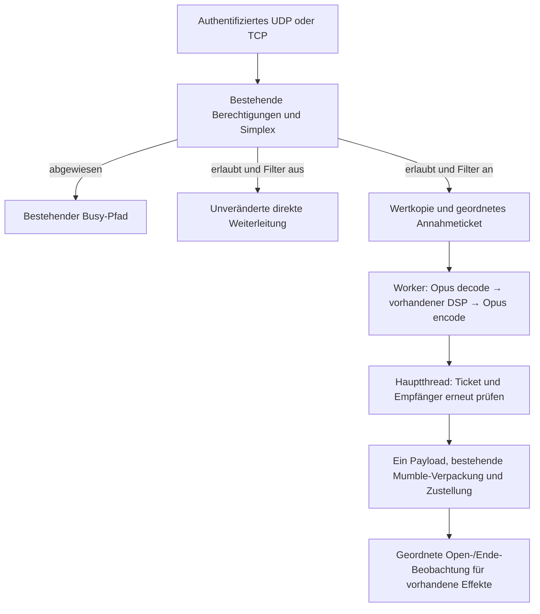

# Analoge Sprachfilter: Integrationsplan, Phase 2A

Status: **Architekturentwurf, keine Serverintegration und keine Betriebsfreigabe.**
Prüfstand: veröffentlichter `dev` am 7. November 2026,
`98bc239e8b8ef8da6dc46faa2830562d5349d224`. Dokumentationsbranch:
`feature/analog-voice-integration`. `dev` und `stable` bleiben unverändert.

Die Klangprofile wurden laut Betreiber nach Anhören der Phase-1-WAVs freigegeben.
Dieser Auftrag ändert weder die Parameter noch den DSP und erzeugt keine Hörproben.
Die Freigabe der Offline-Klänge ersetzt keinen späteren Live-Hörtest.

## 1. Verfügbare Grundlage und Abgrenzung

Phase 1 ist tatsächlich vorhanden, nicht aus einer Beschreibung rekonstruiert:
lokaler Branch `feature/analog-voice-profiles`, Commit
`86071c3771b9976d3a1a359fa04fd5e3770f81da`. Die vollständige eigenständige Engine,
Tests und Dokumentation sind zugänglich und zusätzlich beim Betreiber gesichert.
**Sie sind noch nicht in Dev enthalten.** Dieser Dokumentationsbranch übernimmt
keinen Engine-Code, keine Aufnahmen und keine privaten Sicherungsarchive.

Unverändert wiederzuverwenden sind `tools/analog-voice/include/VoiceProcessor.h`
und `tools/analog-voice/src/VoiceProcessor.cpp`, insbesondere `profile()`,
`Parameters`, `VoiceProcessor::process()` und `reset()`. SHA-256 des geprüften Stands:

```text
VoiceProcessor.h   e33e0101f3a201f2a80b1aa0766664d1e68d8c887e8e1cba7a4ba4fe7367b13c
VoiceProcessor.cpp a3ad1bfaa668ea0b7d0e14ecd1803e24e7fdcc25d0abb25c4818b5cb52ca526f
```

DSP: 48 kHz, Mono-float, in-place für höchstens 960 Samples, zustandsbehaftet,
ohne Heap-Allokation, Sperren, WAV-/Netzwerkzugriffe oder eigenen Lookahead.
Die freigegebenen Presets `cb-am`, `business-fm`, `narrowband` bleiben unverändert.

**Nicht als Live-Pipeline übernehmen:** `Preview.cpp` liest zweimal streamend für
den dateiweiten Pegelvergleich. `OpusCodec::process()` kodiert UND dekodiert eigene
PCM-Frames und akzeptiert nur 960 Samples. Auf dem Server ist die erste Kodierung
bereits im Client erfolgt. Benötigt werden genau ein eingehender Decoder und ein
ausgehender Encoder pro Sender, keine zwei neuen Roundtrips und kein WAV-Adapter.

## 2. Geprüfter Ist-Zustand

Die folgenden Zeilen beziehen sich ausschließlich auf den oben genannten Dev-Commit:

| Stelle | Tatsächliche Aufgabe / Konsequenz |
| --- | --- |
| [Server.cpp](../../src/murmur/Server.cpp), `run()` etwa 1037–1143 | Authentifiziert/entschlüsselt UDP, protokolldekodiert, setzt die echte Sender-Session; ruft `processMsg()` unter Voice-Read-Lock auf. |
| `Server::message()`, etwa 2001–2033 | TCP-`UDPTunnel` führt unter demselben Read-Lock in denselben Sprachpfad. |
| `processMsg()`, 1351–1403 | Authentifizierung, Mute/Suppress, Bandbreitenprüfung und `SimplexController::begin()`. Abgewiesene Sender erhalten gegebenenfalls Busy und werden nicht weitergeleitet. |
| `processMsg()`, 1405–1535 | Empfängerauswahl. Simplex erlaubt nur den eigenen Kanal, keine Links, Listener-Proxys, Whisper oder Loopback. |
| `processMsg()`, 1539–1594 | Gruppiert Empfänger nach Protokoll/Metadaten und leitet unveränderte Opus-Nutzdaten weiter. `UDPAudioEncoder` verpackt Mumble-Pakete; er ist kein Opus-Audioencoder. |
| `processMsg()`, 1595–1620 | Erst nach der Weiterleitung beobachtet `SquelchPlan` gültige Opus-Pakete und erzeugt Open/Close/Noise-Anforderungen. |
| `Server`-Konstruktor, 125–149 | Simplex-Release-Callback: bestätigtes Ende wird später im Paketpfad behandelt; Timeout geht in `SquelchPlan::timeout()` oder Invalidierung. Timer alle 50 ms. |
| `deliverAudioFeedback()`, 2087 ff. | Hauptthread, Voice-Write-Lock per `tryLockForWrite()`, bei Konflikt kurze Timer-Wiederholung. Eigene Empfänger-Session für den privaten Effektstream; Zustellung über TCP-Tunnel. |
| `connectionClosed()`, etwa 1939, `userEnterChannel()`, etwa 2327, `invalidateSimplexIfIneligible()` | Geschützte Stellen für Disconnect, Kanalwechsel und Rechteentzug. |

[SimplexController.cpp](../../src/murmur/SimplexController.cpp) hält einen eigenen
Mutex über den zurückgegebenen `Transmission`-Guard. Er gilt im heutigen Code bis
zum Abschluss von Weiterleitung und Effektbeobachtung. Eine Ende-Markierung darf
deshalb nicht vom nächsten Sender überholt werden. Der Mutex serialisiert diese
kurzen Abschnitte auch über verschiedene Kanäle. `expire()` und Release-Callbacks
laufen ebenfalls unter diesem Mutex. **Kein Codec unter diesem Lock.**

[AudioReceiverBuffer](../../src/murmur/AudioReceiverBuffer.h) ist kein Audiopuffer:
er enthält Referenzen auf lebende `ServerUser`-Objekte. Er darf nicht an Worker
übergeben werden. Ebenso ist `AudioData::payload` nur ein geliehener `gsl::span`
auf Decoder-/Eingangsspeicher. Vor asynchroner Übergabe ist eine eigene Kopie nötig.

[AudioFeedback.cpp](../../src/murmur/AudioFeedback.cpp) und
[RadioNoise.cpp](../../src/murmur/RadioNoise.cpp) bilden bei aktivem Rauschen bereits
**einen privaten Open → Noise → Close → Ende-Stream pro Empfänger** mit durchgehendem
Encoderzustand. Produzenten haben drei Pakete Vorlauf und eine Abschlussreserve.
`tickRadio()` führt `due += 20000` auf der Medienuhr fort; ein Timerkonflikt darf
keinen ganzen Ausgabezyklus verlieren. Stallgrenze 100 ms, Close-Anlaufgrenze
300 ms, bei unabhängigen Streamabschlüssen 60-ms-Retirement. Für kontinuierliche
Effekte gilt die vorhandene TCP-Puffergrenze 1024 Byte, sonst 65536 Byte.

Diese Schutzmechanismen bleiben erhalten. Die Dokumentation
[MurmurLocking.md](../dev/MurmurLocking.md) wurde berücksichtigt. Ein Codec-Worker
wäre ein **neuer dritter Ausführungskontext**; die heutigen Server-Zugriffsregeln
gestatten ihm keinen direkten Zugriff auf Benutzer, Kanäle oder TLS-Verbindungen.

## 3. Entscheidung: begrenzter Worker, einmalige Verarbeitung pro Sender

Empfehlung: zwei neue Bausteine, zunächst **ein vorab gestarteter Worker pro
virtuellem Server**, keine Threads pro Empfänger oder PTT-Vorgang:

1. **`AnalogVoiceStream`**: ein Decoder, unveränderter `VoiceProcessor`, ein
   Encoder; begrenzte PCM-Frames, Sequenzabbildung und Abschlussreserve.
2. **`AnalogVoiceService`**: vorab reservierte Streamplätze, Eingangs-/Ergebnisringe,
   Annahmetickets, Lifecycle und geordnete Hauptthread-Zustellung. Worker bearbeitet
   Sender fair, ohne Serverobjekte zu benutzen. Keine allgemeine Audio-Middleware.



Synchrone Verarbeitung direkt in `processMsg()` wäre zwar weniger neuer Code,
würde aber Voice-/Simplex-Sperren verlängern und bei TCP den Hauptthread samt
Effekttimer belasten. Ein temporäres manuelles Freigeben dieser Sperren genügt
nicht: Pointer-Lebenszeiten und die Ende/Nachfolger-Reihenfolge würden ungültig.
Der Worker ist deshalb die empfohlene Zielarchitektur; sein Ordnungsvertrag muss
**vor** dem ersten Codec im Server durch Tests bewiesen werden.

Erster Funktionsumfang: reguläre Opus-Sprache im bestehenden Simplex-Modus.
Andere erlaubte Codecs/Pfade bleiben beim bisherigen Verhalten; keine zusätzliche
Whisper-/Link-/Loopback-Unterstützung und keine Änderung von Simplex-Regeln.
Ein neu kodiertes Opus-Payload wird einmal erzeugt und an alle erlaubten Empfänger
verteilt. Protokollvarianten, Positionsdaten, Lautstärke-Metadaten und individuelle
Verschlüsselung bleiben Aufgaben des vorhandenen Versandwegs, keine neue Kodierung
pro Empfänger. Senderidentität bleibt die tatsächliche Session, niemals Bot oder
Empfänger-Session; der private Effektstream bleibt davon getrennt.

## 4. Annahme, Reihenfolge und Sperren: zwingender Vertrag

1. Eingang und Simplex-Prüfung bleiben auf den vorhandenen Threads. Kein Worker
   entscheidet erneut über das Senderecht oder ruft später `begin()` für Ergebnisse.
2. **Noch unter dem bestehenden `Transmission`-Guard** wird ein begrenztes Ticket
   atomar eingeordnet: Verbindung, Session, Kanal, Übertragungsgeneration,
   aufsteigende Kanal-Ticketnummer, Quellframe, Dauer, Endeflag, monotone Zeit,
   Payloadkopie und Empfänger-Identitäten als Werte. Erst dann endet der Guard.
3. Nur bei eingeschaltetem Filterpfad ersetzt diese geordnete Übergabe den heutigen
   Vertrag „Guard bis nach Versand“. Die Senderechtsentscheidung, Release-Zeit und
   Busy-/Retry-Regeln bleiben gleich. Eine Änderung dieser Schutzstelle ohne
   Ersatzvertrag ist ein Blocker, kein zulässiger Schnellweg.
4. Pro Kanal gibt es eine Zustellbarriere: letztes Ergebnis/Ende von A wird vor dem
   ersten Ergebnis von B abgearbeitet. Ergebnisse anderer Kanäle können passieren.
   Auch ein wegen Ressourcenmangel **ungefilterter** Nachfolger muss hinter eine
   vorhandene Barriere; er darf die wartende gefilterte Sprache nicht überholen.
5. Der Hauptthread übernimmt fertige Daten per zusammengefasster Queued-Notification,
   nicht ein unbegrenzt wachsendes Qt-Event pro Paket und nicht über den 20-ms-
   Effekttimer. Er prüft Tickets/Identitäten unter Voice-Lock und nutzt anschließend
   den vorhandenen Paket-/Sendepfad. Ein `sendMessage()`-Aufruf ist eine lokale
   Übergabe, keine Bestätigung der Netzwerkzustellung oder Client-Wiedergabe.
6. Kein Worker besitzt `ServerUser*`, `Channel*`, `AudioReceiver`, geliehene Spans
   oder Qt-Sockets. Empfänger werden erst im Hauptthread neu aufgelöst. Dort gilt
   die Schnittmenge aus dem bei Annahme erlaubten Empfängerset und jetzt noch
   berechtigten Empfängern; später Beigetretene erhalten keine alten Audiopakete.

Lock-Reihenfolge: bestehender Voice-Lock → Simplex-Mutex → sehr kurze Inbox-
Übergabe. Produzenten warten nicht auf den Worker. Worker nimmt eigene Daten aus
der Inbox, gibt deren Sperre frei und führt erst dann Codec/DSP aus. Er hält beim
Melden von Ergebnissen keine Codec-/Serversperren. Der Dispatcher hält niemals
eine Inbox-Sperre während Versand und ruft nicht rückwärts in Simplex zurück.

Ende/Abbruch brauchen reservierte Kontrollplätze bzw. generationgebundene atomare
Flags; sie dürfen nicht wie verlierbare Diagnoseereignisse behandelt werden.
Die Simplex-Callbacks dürfen keine Voice-Sperre anfordern: `expire()` kann ohne
diese Sperre, aber mit Controller-Mutex laufen. Kein Warten/Join/Encoding im Sink.
Die vollständige neue Reihenfolge ist in `MurmurLocking.md` zu ergänzen.

## 5. Identitäten, Lebensdauer und schnelle Wechsel

Schlüssel ist **nicht allein die wiederverwendbare Sessionnummer**, sondern
`diagnosticConnection + session + channel + transmissionGeneration`. Hinzu kommt
ein Routing-/Berechtigungsepoch für Sender und Empfänger, der bei relevantem
Kanal-/Rechtewechsel fortgeschaltet wird. Eine Verbindung, die aus einem Kanal
hinaus und zurück wechselt, darf keine alten Ergebnisse empfangen.

Die Übertragungsgeneration wird am tatsächlich angenommenen Anfang erzeugt, nicht
aus einem Logger oder allein aus Frame 0 abgeleitet. Quellenzähler dürfen nach
der bisherigen Quiet-/Retry-Regel zurückgesetzt werden. Workerplätze haben eigene
Epochen; Recycling verwirft alte Arbeit auch nach wiederverwendeter Slotnummer.

Ein angenommenes letztes Paket bleibt für seinen geordneten Abschluss gültig,
obwohl `begin()` beim Marker bereits das Senderecht freigibt. **Nicht einfach
„Sender ist noch aktueller Kanalbesitzer“ prüfen**: Das würde gerade letzte
Sprachpakete verwerfen. Stattdessen gelten das angenommene Ticket, die Barriere
und die weiterhin gültigen Identitäten/Rechte. Ein Disconnect oder tatsächlicher
Rechte-/Kanalentzug invalidiert dagegen auch wartende Alt-Ergebnisse sofort.

Nach Kanalwechsel, Disconnect oder Entzug des Senderechts: vorhandene Simplex-
Invalidierung beibehalten, neue Verarbeitung zusätzlich abbrechen, Slots erst nach
Abschluss ihrer alten Generation wiederverwenden. Keine neue Close-Ausgabe für
einen dadurch ungültigen Sender. Deaf/SelfDeaf betrifft Empfängerrechte und darf
nicht versehentlich als zusätzliche Simplex-Sendesperre eingeführt werden.

Shutdown: keine neuen Jobs, UDP-Thread stoppen, Notifications/Tickets entwerten,
Worker außerhalb aller Voice-/Simplex-Sperren stoppen/joinen, dann Slots und
Serverdaten zerstören. Vorhandene Effekttimer ebenfalls wie bisher stoppen.

## 6. Live-Opus- und Pufferkonzept

### Pakete und PCM

- Eingang bleibt auf das vorhandene `MAX_UDP_PACKET_SIZE = 1024` einschließlich
  Mumble-Hülle beschränkt. Opus-Payload und Dauer vor Decoderarbeit begrenzt prüfen.
- Libopus kann an 48 kHz bis zu 5760 Samples/120 ms pro Paket liefern. Der neue
  Decoder benötigt dafür einen festen 5760er-Puffer; der Phase-1-960er-Decoder
  genügt ausdrücklich nicht. Die PCM-Ausgabe wird in höchstens 960er-Stücken durch
  den unveränderten DSP geführt und für 20-ms-Ausgangspakete zusammengesetzt.
- Unterstützte Startmenge: gültige Mono-Pakete mit Dauer in ganzen 10-ms-Einheiten
  (10 bis 120 ms, soweit die konkrete Opus-Paketierung sie erlaubt). Ein gültiges
  2,5-/5-ms-Paket oder nicht unterstützter Kanalmodus führt vor erstem gefiltertem
  Versand zu gelatchtem Bypass; keine erfundene Bruchteil-Sequenz im Mumble-Protokoll.
  Die genaue Windows-/Mumla-Paketierung ist im Adaptertest zu bestätigen.
- Zwischenpakete werden nicht mit Stille aufgefüllt. Ein Rest unter 960 Samples
  wartet auf echte Folgesamples; Padding nur am tatsächlichen technischen Ende.
  Ein 60-ms-Paket kann drei geordnete 20-ms-Payloads erzeugen. Diese dürfen zusammen
  zugestellt werden: ihre Zeitstempel führen den Client-Jitterbuffer. Kein neuer
  starrer 20-ms-Timer, der bei Jitter Pakete verschluckt oder künstlich nachläuft.

Beim Zusammenfassen zweier 10-ms-Eingänge darf der Empfängerkreis nicht als
Vereinigung erweitert werden: ein neuer Empfänger bekäme sonst die ältere Hälfte
mit. Der fertige Block übernimmt nur den gemeinsamen berechtigten Snapshot seiner
Quellanteile; zusätzliche aktuelle Prüfungen bleiben nötig. Positionsmetadaten am
ersten beitragenden Sample verankern. Nie über Sender-/Routingepochen hinweg
zusammenfassen. Die begrenzte Zuordnung von Quellpaketen zu Ergebnisblöcken trägt
auch die später genau einmal auszuführenden Squelch-Beobachtungen.

### Eingangs- und Ausgangsmedienuhr

Die Mumble-Framezahl zählt hier **10-ms-Einheiten**, nicht Opus-Pakete. Das zeigen
`AudioInput::flushCheck()` und `AudioOutputSpeech::addFrameToBuffer()`; letzteres
setzt den Jitter-Zeitstempel aus Framezahl und 10-ms-Framegröße zusammen. Der
Server-Adapter führt einen getrennten Quellcursor und Ausgangscursor: 20-ms-
Ausgaben erhöhen den Ausgangscursor jeweils um 2; 60-ms-Eingänge umfassen 6.
Zeitstempel niemals aus Callbackanzahl oder einer auf 60 Sekunden begrenzten Uhr
ableiten. Pro Verbindung über kurze Sendungen hinaus monoton fortführen, neue
Übertragung nicht blind auf 0 setzen. Start ist mindestens der bisher nächste
Ausgangsframe, gegebenenfalls der höhere gültige Quellenstart; Überlauf prüfen.

Der vorhandene Controller verwirft veraltete/duplizierte Pakete bereits vor diesem
Adapter. Er akzeptiert unter bestimmten Bedingungen einen leeren Terminator am
letzten Quellframe. Der Adapter darf diese Regeln nicht neu interpretieren. Kein
zusätzlicher Reorder-Wartepuffer in der ersten Version. Akzeptierte Vorwärtssprünge
werden als fehlende Quellzeit erkannt, nicht durch dichtes Neunummerieren versteckt.
Als anfänglicher Entwurf höchstens 40 ms Decoder-PLC/DSP pro Lücke, darüber die
restliche Medienlücke sichtbar lassen; kein unbegrenztes Nachrechnen. Decoder und
Encoder bleiben innerhalb der Generation erhalten. PLC/Diskontinuitäten benötigen
eigene Qualitäts-/Sequenztests; keine perfekte Reparatur verlorener Sprache versprechen.

### Vorlauf und Abschluss

Der Lookahead des ursprünglichen Client-Encoders steht nicht im Mumble-Payload.
**Keine pauschalen 312 Samples vom eingehenden Decoder abschneiden.** Die Offline-
Simulation kennt beide Encoder; ein Live-Server kennt nur seinen neuen Encoder.
Dessen `OPUS_GET_LOOKAHEAD` ist abzufragen. Zusätzliche algorithmische Verzögerung
bleibt real; sie lässt sich ohne Clientänderung nicht wie ein WAV-Vorlauf wegschneiden.

Bei bestätigtem Ende zuerst die Nutzdaten desselben letzten Pakets verarbeiten,
dann Rest-PCM und ausreichend Nullsamples für den neuen Encoder-Nachlauf kodieren.
Eine echte, ungesendete Abschlussreserve von einem Ausgangspaket bleibt verfügbar.
Erst das letzte endgültige Payload bekommt `isLastFrame=true`; nicht den Original-
Marker vor den Nachlauf schicken, kein dupliziertes altes Opus-Paket als Abschluss.
Die Reserve kostet bis zu 20 ms; das ist Bestandteil des Latenzbudgets.

Leere Eingangsterminatoren und Payload+Terminator werden gleich geordnet beendet.
Timeout: nur auf das tatsächliche `timeout_suspected` des Controllers reagieren,
höchstens einmal je Generation. Ein technischer Abschluss des neu erzeugten
Ausgangsstreams ist **keine Bestätigung physischen PTT-Loslassens** und wird niemals
als bestätigter Eingangsmarker in Simplex oder Diagnosen zurückgespeist.

### Vorläufige feste Grenzen, später auf Zielhardware messen

| Ressource | Startentwurf / Verhalten |
| --- | --- |
| Aktive Codecplätze | 4 pro virtuellem Server, 1 Worker, vorab erstellt; kein Thread pro Empfänger |
| Eingang | Höchstens 4 Paketplätze je Stream, zusätzlich höchstens 120 ms unverarbeitete Medienzeit; ein größtes legales Paket passt hinein |
| PCM | Fester 5760er-Decoderpuffer, 960er-DSP-/Encoderblöcke, höchstens ein teilgefüllter Frame |
| Ausgang | Höchstens 10 Pakete je Stream einschließlich Abschlussreserve und begrenztem EOF-Drain; Plätze vor Annahme eines Jobs reservieren |
| Worker-Wartezeit | Ziel höchstens 40 ms Jobalter; getrennt von der im Client bereits gesammelten Paketdauer messen |
| Steuerung | Reservierter Ende-/Abbruchplatz, eine koaleszierte Qt-Aufweckbenachrichtigung; kein verlorenes Ende bei voller Datenqueue |

Dies sind **Vorschlagswerte**, keine bestehenden Optionen oder gemessenen VPS-Garantien.
Byte-, Medienzeit- und Altersgrenzen müssen gemeinsam gelten; die maximale
zulässige Folge von Frames und EOF-Paketen muss zu den reservierten Slots passen.
Protokollhüllen und Bitrate müssen weiterhin in MTU und Serverbandbreite passen.
Eingehendes Bandbreitenaccounting nicht doppelt ausführen; der neue Ausgang kann
mehr Bitrate benötigen und braucht deshalb eine eigene Budgetprüfung vor Aufnahme.

## 7. Effekte und Reihenfolge: keine zweite Audioarchitektur

Sprach-Opus und privates Effektaudio bleiben zwei getrennte Streams mit getrennten
Identitäten, Sequenzen und Encodern. Kein PCM-Mixing, kein Wiederverwenden des
Noise-Encoders für Sprache, keine Ende-Markierungen zwischen Open/Noise/Close.

Im aktivierten Sprachpfad muss der dünne **Lifecycle-Anschluss** verschoben werden:
`SquelchPlan::observe()` erst nach der zugehörigen tatsächlichen Sprachübergabe,
einmal pro ursprünglichem angenommenem Paket, nicht einmal pro zerlegtem Frame.
Seine Quellframe-/Timeout-Vergleiche verwenden weiterhin die **Quell**nummern,
nicht den neuen Ausgangszähler. Empfänger sind diejenigen, für die Zustellung noch
zulässig war; der ursprüngliche erlaubte Snapshot wird nicht erweitert.

Ein bestätigtes letztes Paket erzeugt Close erst hinter dem fertig zugestellten
Sprachnachlauf. Ein Timeout-Callback darf nicht parallel voreilig `timeout()` oder
`invalidate()` für dieselbe gefilterte Generation ausführen: er hinterlegt einen
geordneten Endauftrag. Bestätigter Marker und Timeout werden generationgebunden
dedupliziert. Ein Marker-Event aus `begin()` darf keinen EOF-Auftrag **vor** seinen
eigenen letzten Payload stellen. Abbruch/Kanalwechsel bleibt dagegen sofort wirksam.

Das ändert nicht den AudioFeedback-Renderer oder dessen Timer. Ein schmaler Adapter
zu `SquelchPlan` benötigt bei verzögertem Ende die ursprüngliche monotone Endzeit,
damit die vorhandene **300-ms-Close-Frist nicht durch einen späteren Aufruf künstlich
neu startet**. Original-Endzeit bis Cue/Request durchreichen, keine Frist erhöhen.
Ein überfälliger optionaler Close darf ausfallen; er darf weder Sprache blockieren
noch an eine jüngere Übertragung angehängt werden. Busy bleibt priorisiert.

Bei sehr schnellem Nachfolger darf ein alter optionaler Close wie bisher durch
die jüngere Generation ungültig werden. Die Zustellbarriere ordnet Sprache und
Ende, garantiert aber nicht das Abspielen jedes optionalen Tons vor neuem Open.
Neue Sprache nicht zur Rettung eines alten Close blockieren.

Serverseitige Übergabereihenfolge beweist keine Wiedergabereihenfolge zwischen
UDP-Sprache und TCP-Effekten auf dem Client. Encoder-Latenz, letzter großer
Eingangsblock und zwei Client-Jitterbuffer bleiben ein Live-Hörrisiko. Die
erfolgreiche gemeinsame Effektstream-Lösung darf nicht durch neue Trennungen oder
eine pauschale 200-ms-Pause zurückgebaut werden. Insbesondere Noise-Unterbrechungen,
TCP-Druck, Produzentenstarvation und kurze Timer-Lockkonflikte bleiben Regressionen.

## 8. Fehler, Überlast und ehrliche Fallback-Grenzen

Vor dem ersten gefilterten Versand: nur bei reservierten gesunden Ressourcen
aufnehmen. Bei fehlendem Platz/geeigneter Paketierung den **ganzen Versuch** auf
unveränderte Sprache latchen; keine wiederholte Entscheidung pro Paket. Auch
Bypass folgt gegebenenfalls der bereits bestehenden Kanal-Zustellbarriere.

Auch Bypass-/Nachfolger-Tickets benötigen begrenzte Plätze. Ein voller Kanalpuffer
darf weder unbegrenzt wachsen noch durch sofortigen Versand am wartenden Ende
vorbeigeführt werden. Wenn selbst dessen reservierter Übergabeplatz erschöpft ist,
gilt ein gezählter Zustellfehler nach der folgenden Fehlerpolitik; verlustfreie
Originalzustellung ist in diesem Überlastfall nicht zugesagt.

Nach Beginn eines neu kodierten Streams ist ein stilles Umschalten auf Original-
Opus **kein bewiesener sicherer Fallback**: anderer Encoderzustand, Sequenz- und
Decodertransienten. Der erste Entwurf sieht deshalb bei Codecfehler, dauerhaftem
Queueüberlauf oder abgelaufener Arbeit einen erkennbaren Zustand `Faulted` vor:
alte Ergebnisse entwerten, vorhandene Abschlussreserve nach aktueller Berechtigung
bestmöglich terminieren, keinen Codec mehr in dieser Generation neu starten.
Weitere Sprache dieser fehlerhaften Generation kann verloren gehen; bis zum
nächsten echten Start bleibt der Fehler gelatcht. Kein falsches bestätigtes Ende,
kein erzwungenes Simplex-Release und kein verspäteter Close. Betroffene optionale
Effekte werden über vorhandene Invalidierung beendet, nicht neu gebaut.

Das ist ein bewusst sichtbarer **Verfügbarkeitsnachteil im Fehlerfall**, keine
verlustfreie Fail-open-Zusage. Begrenzte Ressourcen, niemals wartender Sprachpfad
und garantierte verlustfreie Sprache bei beliebiger Überlast sind nicht gleichzeitig
erfüllbar. Diese Politik muss vor Betriebsfreigabe mit dem Betreiber bewertet und
mit Überlasttests abgesichert werden; im Zweifel bleibt das Feature deaktiviert.
Kein spekulativer Midstream-Codecwechsel zur Verschleierung eines Fehlers.

Für Logs: nur sparsame Zähler/Latenz-Histogramme und Fehlergründe; keine Sprachdaten,
Passwörter oder privaten WAV-Pfade. Jobverlust und optionaler Effektverlust getrennt
zählen. Fehlende Empfänger oder Disconnects verlangen keine Nachlieferung.

## 9. Konfiguration und Klangübereinstimmung

Vorgeschlagene neue Serverkonfiguration, noch **nicht implementiert**:

```ini
analogvoice=false
analogvoiceprofile=cb-am
analogvoicebitrate=40000
analogvoiceheadroomdb=3
```

Fehlender Aktivierungseintrag bedeutet immer false, auch in alten INIs. In dieser
ersten Integrationsphase keine automatische Aktivierung durch Ubuntu/Docker und
keine Umschreibung bestehender Konfigurationen. Ohne Simplex oder bei ungültiger
Profil-/Ressourcenkonfiguration Sprachfilter nicht aktivieren und einmal eindeutig
warnen; bestehender Server-/Sprachbetrieb bleibt verfügbar. Konfiguration nur beim
Start übernehmen, keine Profil-/Codecwechsel mitten in einer Übertragung.

`analogvoice=false`: kein Worker, keine Codecslots/Queues, keine veränderte
Squelch-Verarbeitung und **keine Decode/Encode-Kette**. `processMsg()` nimmt den
heutigen direkten Pfad mit identischen Nutzdaten und Metadaten. PCM-Bypass innerhalb
eines Decoders wäre dafür nicht ausreichend. Fehlende alte Schlüssel dürfen keinen
impliziten Effekt aktivieren. Weder neue Ports noch Clients/Protokolländerungen.

Die Offline-Hörproben hatten 3 dB Reserve **vor** dem ersten Encoder und einen
aufnahmeabhängigen konstanten RMS-Abgleich. Live kommt Opus bereits an: Reserve
kann erst nach dem Decoder angewandt werden; ein dateiweites RMS-Gain ist ohne
Warten auf das Ende unmöglich. Keine heimliche Echtzeit-AGC als Ersatz einführen.
DSP-Presets unverändert lassen, zunächst ohne Aufnahme-RMS-Abgleich arbeiten und
Live-Pegel separat durch Hörtests beurteilen. Deshalb ist byte-/klangidentisches
Verhalten zu den Offline-Dateien nicht zugesagt. Eine spätere statische
Ausgangspegelentscheidung benötigt eigene Messung/Freigabe.

## 10. Ressourcenbewertung für kleine VPS

Phase-1-Messung: DSP-Zustand 392 Byte. 60 s synthetisches Audio benötigten in der
Cloud etwa 0,24–0,31 s reinen DSP bzw. 2,44–4,25 s für **zwei** vollständige
Opus-Roundtrips mit DSP. Das ist weder ein Benchmark dieses noch nicht gebauten
Live-Adapters noch des 2-GB-VPS. Der Live-Pfad braucht ein Codec-Paar statt zwei.

Mit festen Puffern liegt die zusätzliche Zustandsgröße grob im Bereich einiger
hundert KiB pro Slot; wirkliche Größen über `opus_encoder_get_size(1)` und
`opus_decoder_get_size(1)` plus Buffer-/Metadatenbudget des Zielbuilds ermitteln.
Workerstack, Bibliotheken, bestehende Noise-Produzenten, Datenbank und übrige
Serverlast kommen hinzu. Ein Worker und vier Slots sind ein konservativer
Startentwurf, keine Aussage über zuverlässig mögliche parallele Kanäle.

Auf Zielhardware messen: p50/p95/p99 Codec- und Queuezeiten, schlimmster Tick bei
120-ms-Paketen, CPU/RSS unter mehreren aktiven Kanälen plus Rauschen, Start-/End-
Burst, Maximalnutzerzahl, UDP-Last und TCP-Stau. Admission soll Ressourcenmangel
vor der gefilterten Ausgabe erkennen. Idle-Sender erhalten keine periodische
DSP-/Codecverarbeitung. Pool wird wiederverwendet, Zustand pro Generation bewusst
zurückgesetzt. Keine Speicherung ganzer Sendungen und keine eigene Audiodatei im
Live-Pfad.

## 11. Konkrete spätere Änderungen und Umsetzungsschritte

| Schritt | Kleiner abgrenzbarer Inhalt | Danach zwingend prüfen |
| --- | --- | --- |
| B1 – unveränderten Kern importieren | Phase-1-Quellen aus geprüftem Commit/Archiv übernehmen, obige Hashes prüfen, DSP als eigenes CMake-Target anbinden. Offline-Testprogramm und freigegebene Parameter erhalten. Kein Serverpfad aktiv. | Bestehende DSP-/WAV-/Codec-Tests, keine GUI-/Python-Abhängigkeit des Server-DSP-Targets; noch keine Sprachwirkung. |
| B2 – reiner Live-Adapter | `AnalogVoiceStream` außerhalb `Server`: externe Opus-Payloads dekodieren, 10…120 ms reblocken, einmal neu kodieren, Sequenz-/EOF-/Reserveverhalten. Kein Netzwerk. | Vollständige Dekodierbarkeit, erste/letzte Silben-Testsignale, 10/20/40/60/120 ms, Ein-Paket-Sendungen, leerer Marker, Payload+Marker, PLC, Duplikate, >60 s, keine Framezahlrücksprünge. |
| B3 – geordneter Dienst ohne Audioänderung | `AnalogVoiceService` mit begrenzten Slots/Tickets und Fake-Worker; nötige optionale Guard-/Lebensdauerübergabe in `Server::processMsg()`, Hauptthread-Dispatcher und Control-Invalidierung. | A-Ende/B-Anfang über UDP und TCP, langsamer/abgebrochener Worker, Raw-Nachfolger, Slot-/Session-Reuse, Empfänger raus/zurück, Disconnect, Deadlock-/Racetests. Keine Codecarbeit unter Serversperren. |
| B4 – experimenteller Schalter und Codec | `Server.h/.cpp`: Servicebesitz, Start/Stop und optionaler Pfad; Konfiguration in `Meta.h/.cpp`, Server-`getConf` und CMake. Empfänger-/Sendelogik in eng begrenzte gemeinsam nutzbare Helfer lösen, keine zweite Routingimplementierung. | Feature aus/fehlend: vollständige bisherige Payload-/Metadaten-Identität; Feature an: exakt eine Verarbeitung pro Sender, gleiche Payloads für Empfänger, richtige Session/Protokollversion/Position/Volume, TCP und verschlüsseltes UDP. |
| B5 – Effekt-Lifecycle anschließen | Optionaler Zweig im Simplex-Event-Callback und nach tatsächlicher Sprachübergabe; `SquelchPlan` schmal um ursprüngliche Endzeit ergänzen. Renderer, Noise-Encoder, Timer und Busy unverändert lassen. | Marker-/Timeout-Ende, kein Doppel-Close, kein Close ohne gültigen Anfang/nach Kanalwechsel/Disconnect; originale 300-ms-Frist, gemeinsamer Open/Noise/Close-Stream, Busy-Unterbrechung, alle bisherigen Störfälle. |
| B6 – Freigabevorbereitung | Ziel-VPS-Benchmark, später minimal notwendige Konfigurationsdokumentation. Keine automatische Datenmigration oder Änderung bestehender Ports. | Bestehende Server-/Installer-/Docker-Tests sowie echte Windows-Mumble/Mumla-Hörtests; Lastgrenzen, Pegel und Fehlerpolitik bewerten. Erst danach gesonderte Betriebsfreigabe. |

Voraussichtlich betroffen sind damit `Server.cpp/.h`, `Meta.cpp/.h`, kleine neue
Adapter-/Service-Dateien und deren CMake-/Testanbindung sowie
`docs/dev/MurmurLocking.md`. `SimplexController` behält seinen Entscheidungsalgorithmus;
die neue optionale Bedeutung des Guard-Übergabepunkts braucht dokumentierte Tests
und gegebenenfalls einen schmalen expliziten Übergabevertrag, keine neue Funklogik.
`AudioReceiverBuffer` bleibt Werkzeug des Dispatcher-/Serverthreads. Bestehende
`Messages.cpp`-Kontrollpfade nur dort ergänzen, wo sie wirklich einen relevanten
Epochwechsel auslösen. Keine vorsorglichen breitflächigen Änderungen.

## 12. Abnahmetests und offene Nachweise

Vor Freigabe den vorhandenen Testbestand vollständig wieder ausführen, insbesondere
`TestSimplex`, `TestSimplexIntegration`, `TestAudioFeedback`,
`TestAudioFeedbackIntegration`, `TestSquelchFoundation`, `TestSquelchPassthrough`,
`TestSquelchIntegration`, `TestSquelchTimeoutEnd`, `TestRadioNoise`,
`TestNoiseScheduler`, `TestNoiseTiming`, `TestNoisePlayoutModel`,
`TestNoiseIntegration` und `TestMumbleProtocol`. Neue deterministische FakeClock-/
Worker-Sperrtests ergänzen; keine bestehenden Zeitlimits pauschal vergrößern.

Zusätzlich: gleichzeitiger UDP-/TCP-Eingang desselben Senders, Transportwechsel,
gefälschte/stale Marker, Endauftrag bei voller Datenqueue, Ergebnis nach Timeout,
Filterplatz vor erstem Output nicht verfügbar, Fehler nach erstem Output,
Shutdown während Encoding, viele Empfänger, nicht unterstützte Pakete und
Bandbreiten-/Speicherobergrenzen. Testen, dass alte Empfängersnapshots keine
Berechtigungserweiterung erzeugen und neue Sender nicht an alte DSP-Zustände gelangen.

Echte Hörtests: kurze, sehr kurze und >60-s-Sendungen in beiden Richtungen zwischen
Windows-Mumble und Mumla, mit/ohne Rauschen, schneller PTT-Wechsel, bestätigtes Ende
und Mumla-Timeout, Paketverlust und Last. Sprache, Effekte und Wiedergabeverzögerung
getrennt beurteilen; Codec-/Puffermodelltests sind keine bestätigten Gerätehörtests.

**Noch offen für Phase 2B:** Beweis des asynchronen Guard-/Kanal-Barrierenvertrags,
Sequenz-/PLC-/Nachlaufmodell im Live-Client, Zielhardware-Lastbudget und Bewertung
der sichtbaren Midstream-Fehlerpolitik. Konkrete Clientversionen, Paketdauern und
Mikrofon-AGC/Pegel für den Live-Test festhalten. DSP-Quellen oder Klangprofile fehlen
nicht; ein Filter-Neuentwurf ist nicht erforderlich. Diese offenen Punkte blockieren
eine Betriebsfreigabe, nicht die Veröffentlichung dieses Architekturentwurfs.

## 13. Umfang und Validierung dieser Phase 2A

Nur diese Dokumentation wird versioniert. Relevante Serverdateien und die
Phase-1-Schnittstellen wurden gezielt gelesen; Quellbasis, lokale Engine-Dateien
und Dokumentationsverweise geprüft. Keine neuen Builds, Audioverarbeitung,
Hörproben, Server-/Installeränderungen oder Deployments. In diesem Auftrag wurden
keine neuen Server-/Codec-/Hörtests durchgeführt; frühere Zahlen sind als solche
gekennzeichnet. Kein automatischer Merge und **keine Umsetzung von Phase 2B**.
